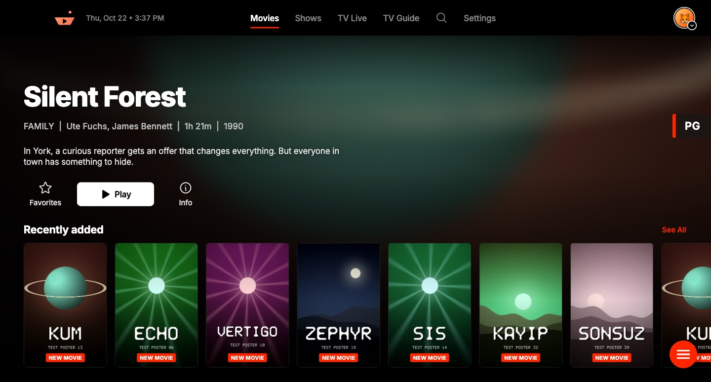
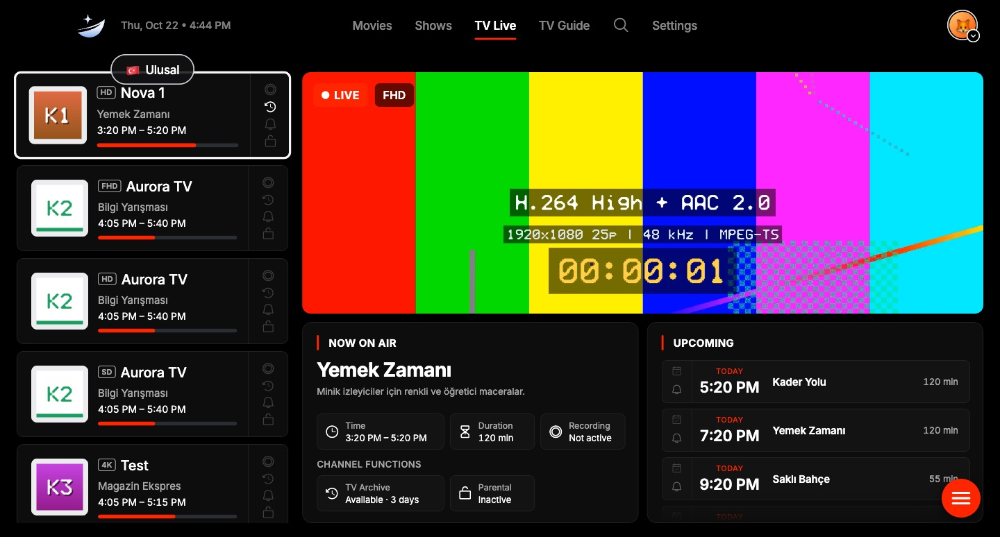
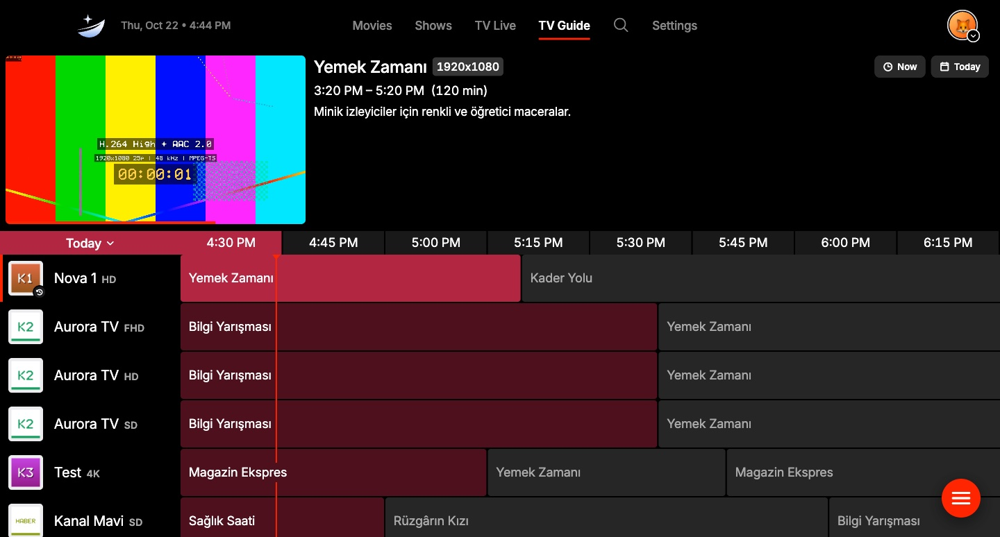
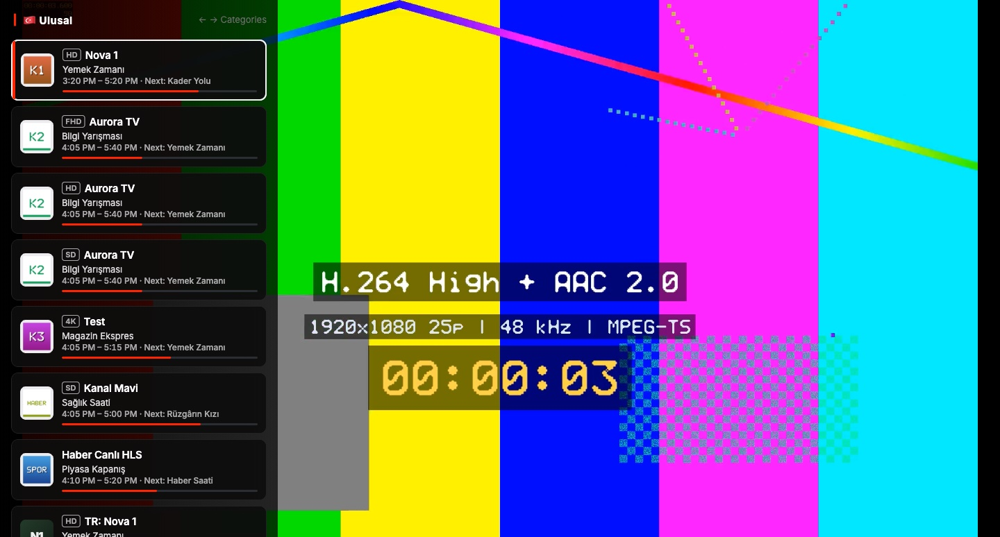
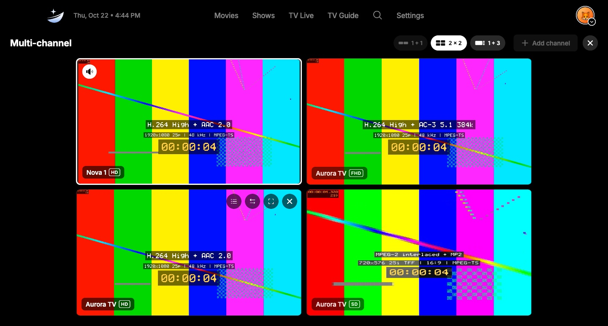
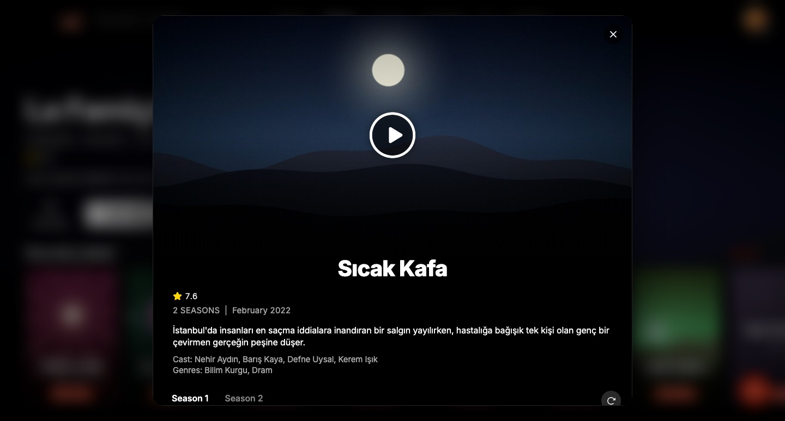

<div align="center">


# Carina

**A fast TV player for your own playlists.**
Windows, macOS, Android TV and LG webOS. English and Turkish.

[](https://github.com/egemenmermer/carina/releases)
[](LICENSE)

[](https://github.com/egemenmermer/carina/releases/download/v1.1.0-beta.1/Carina-Setup-1.1.0-x64.exe)
[](https://github.com/egemenmermer/carina/releases/download/v1.1.0-beta.1/Carina-1.1.0-35-macos.zip)
[](https://github.com/egemenmermer/carina/releases/download/v1.1.0-beta.1/Carina-1.1.0-36-androidtv.apk)
[](https://github.com/egemenmermer/carina/releases/download/v1.1.0-beta.1/Carina-0.1.0-4-webos.ipk)

**Kolay kurulum (Türkçe): [egemenmermer.github.io/carina](https://egemenmermer.github.io/carina/)**

[Install](#install) · [Screenshots](#screenshots) · [Features](#features) · [Build from source](#build-from-source)

**Open source · No channels included · Bring your own Xtream Codes or M3U**

</div>



Carina is a player only. It ships with no channels, no content and no
provider. You add your own Xtream Codes account or M3U playlist (with an
optional XMLTV guide), and Carina turns it into live TV, a TV guide, movies
and shows.

Carina is the sibling of [Vela](https://github.com/egemenmermer/vela): in the
old Argo Navis constellation Vela is the sails and Carina the hull.

## Screenshots

### TV Live

Channel list with an in-place preview, what is on now and what comes next.



### TV Guide

A full programme grid with catch-up for channels that have an archive.



### Player

Full-screen playback with the channel list and mini guide on top.



### Multi-channel

Up to four live channels at once.



### Shows

Seasons, episodes and details for series.



These screenshots come from the app's real interface with the built-in demo
server (`tools/mock_server`): channel names, programmes and posters are made
up test data.

## Features

- **Playlists:** Xtream Codes, M3U URL or local M3U file; live checks while
  you type, an import stepper, incremental reloads that keep favorites, watch
  state and renames; several playlists with avatars and an optional access PIN.
- **TV Live:** horizontal and vertical layouts, an in-place live preview,
  NOW ON AIR and UPCOMING panels, number zapping, last watched, custom EPG
  matching, hidden and locked channels.
- **TV Guide:** a custom-painted, virtualized grid (1,000 channels × 7 days
  scrolls at 60 fps), programme details, catch-up / TV archive.
- **Movies and Shows:** hero, Continue watching, Favorites, Recently added,
  category rows, See All grids, detail sheets with seasons and episodes.
  Optional TMDb artwork with your own API key.
- **Player:** libmpv through media_kit, so AC-3, E-AC-3, HEVC, MPEG-2 and
  interlaced streams all play; audio, subtitle and picture menus, resume,
  next episode, stats overlay and full keyboard control.
- **Multi-channel:** up to four live channels at once (1+1, 2×2, 1+3).
- **Search:** SQLite FTS5 across channels, movies, shows, programmes and
  people, Turkish-insensitive.
- **Parental control:** channel and category locks, hide mode, session unlock.
- **Reminders:** for upcoming programmes.

## Install

Latest build: **[1.1.0 beta 1](https://github.com/egemenmermer/carina/releases/tag/v1.1.0-beta.1)**
(all builds: [Releases](https://github.com/egemenmermer/carina/releases)).

Step-by-step install guide in Turkish, with the right download for your
device: **[egemenmermer.github.io/carina](https://egemenmermer.github.io/carina/)**.

| Platform | Download | How to install |
|---|---|---|
| Windows 10/11 (x64) | [Installer (.exe)](https://github.com/egemenmermer/carina/releases/download/v1.1.0-beta.1/Carina-Setup-1.1.0-x64.exe) · [Portable (.zip)](https://github.com/egemenmermer/carina/releases/download/v1.1.0-beta.1/Carina-1.1.0-win-x64-portable.zip) | Run the installer (per user, no admin rights). Until the first SignPath-signed release SmartScreen asks once: **More info → Run anyway**. |
| macOS 12+ (Apple Silicon and Intel) | [Carina for Mac (.zip)](https://github.com/egemenmermer/carina/releases/download/v1.1.0-beta.1/Carina-1.1.0-35-macos.zip) | Unzip and move **Carina** to Applications. Signed with a Developer ID and notarized by Apple, so it opens without a warning. |
| Android TV / Google TV | [Carina for Android TV (.apk)](https://github.com/egemenmermer/carina/releases/download/v1.1.0-beta.1/Carina-1.1.0-36-androidtv.apk) | Sideload with the **Downloader** app or `adb install`. Allow installs from unknown sources when the TV asks. |
| LG webOS 4+ | [Carina for webOS (.ipk)](https://github.com/egemenmermer/carina/releases/download/v1.1.0-beta.1/Carina-0.1.0-4-webos.ipk) | Needs webOS Developer Mode, see [webos/README.md](webos/README.md). |

Checksums: [SHA256SUMS.txt](https://github.com/egemenmermer/carina/releases/download/v1.1.0-beta.1/SHA256SUMS.txt). Windows keeps its data in
`%APPDATA%\Carina`. Every push also builds all platforms in GitHub Actions
(run artifacts).

## Build from source

Requirements: Flutter 3.47.7 (Dart 3.13.5). On Windows: Visual Studio 2022
with "Desktop development with C++".

```sh
flutter pub get
dart run build_runner build -d   # drift database code
flutter gen-l10n                 # translations
flutter run -d windows           # or: -d macos
```

Tests:

```sh
flutter test
```

The tests run against a deterministic local mock IPTV server
(`tools/mock_server`: Xtream API, M3U, XMLTV, live TS and HLS, VOD with Range
requests and failure endpoints) and generated media (`tools/gen_media.sh`,
needs ffmpeg). Start the server by hand with
`dart run tools/mock_server/bin/mock_server.dart`.

More: [architecture](docs/ARCHITECTURE.md) · [assets and licenses](docs/ASSETS.md) ·
[app icons](tools/icons/README.md).

## Stack

Flutter · media_kit (libmpv / FFmpeg) · Riverpod · go_router · drift + SQLite
FTS5 · dio · package:xml (streaming) · window_manager · Inno Setup.

## Legal

Carina does not provide, sell or link to any TV channels or content. Use it
only with playlists you have the right to watch. When you add a TMDb key,
Carina uses the TMDB API but is not endorsed or certified by TMDB.

## Code signing policy

Windows releases will be signed with free code signing provided by
[SignPath.io](https://about.signpath.io/), certificate by
[SignPath Foundation](https://signpath.org/) (application pending).

- Only builds made by this repository's GitHub Actions workflows from
  commits on `main` are submitted for signing; nothing built on a personal
  machine is signed.
- Committers and reviewers: [Egemen Mermer](https://github.com/egemenmermer).
- Approvers (each signing request is approved by hand):
  [Egemen Mermer](https://github.com/egemenmermer).

### Privacy

Carina connects only to the servers you configure (your IPTV provider's
playlist, stream and guide addresses) and, if you add your own TMDb key, to
the TMDB API for artwork and details. Channel logos and posters load from
the addresses in your playlist. It has no analytics, telemetry or
accounts and sends nothing else anywhere. Playlists, credentials and
settings stay on your device.

## License

[GPL-3.0](LICENSE). Bundled fonts and libraries keep their own licenses; see
[docs/ASSETS.md](docs/ASSETS.md).
